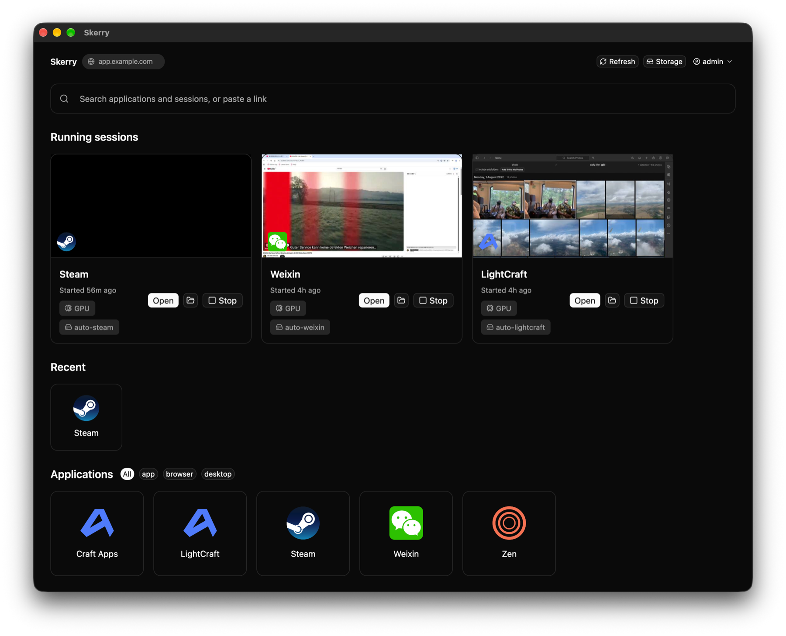
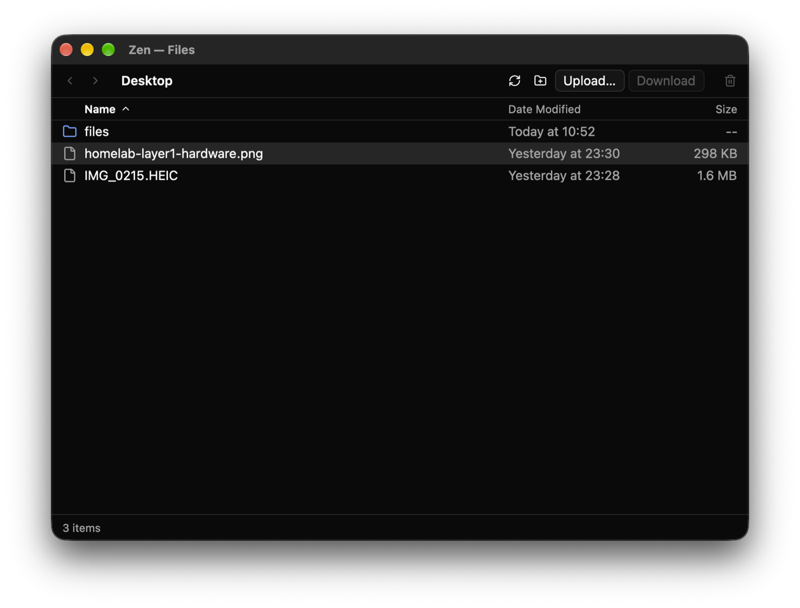

# Skerry

Skerry is a native macOS client for [SealSkin](https://docs.sealskin.app/latest/) and [Selkies](https://github.com/selkies-project/selkies). Connect to your SealSkin server—or directly to a Selkies stream—to launch, resume, and use remote desktop apps in dedicated Mac windows without a browser.


## Why Skerry instead of the web client?

The SealSkin/Selkies web client is great for quick access from any device, but browsers get in the way when you use remote apps every day. Skerry replaces the browser tab with a native Mac experience:

- **No browser chrome or hijacked shortcuts:** Remote apps live in clean, dedicated macOS windows. Shortcuts like `⌘W`, `⌘T`, `⌘N`, and `⌘R` stay with the remote app instead of closing your tab or triggering browser actions, with optional **Command → Control** mapping and a per-server toggle for Mac shortcuts.
- **Zero-copy Apple Silicon video:** Decodes H.264, H.265 (HEVC), and AV1 natively via **Apple VideoToolbox** straight into GPU-backed surfaces rendered with Metal—lower latency, lower memory usage, and no background browser tab throttling.
- **Native macOS input & trackpad feel:** Smooth two-finger trackpad scrolling, pinch-to-zoom, native Mac input methods (IME) for CJK and accented text, Retina/HiDPI scaling, and automatic key release on focus loss so keys never get stuck.
- **Seamless desktop integration:**
  - **Clipboard without browser prompts:** Two-way `NSPasteboard` sync for text, rich HTML, and images, including `ConcealedType` support for secrets (auto-cleared after 60 seconds).
  - **Native Files window & Finder drag-and-drop:** Browse remote folders, preview files with **Quick Look (`Space`)**, and drag files directly between Finder and the session.
  - **Native printing & audio routing:** Remote print jobs open in the standard macOS PDF print sheet, and you can choose any Core Audio output device per session—plus hardware-encoded microphone and webcam forwarding.
- **Multi-window & second display:** Run multiple remote apps side by side in separate windows, or extend a single session onto a **Second Display** window.
- **Gaming & 3D apps:** Native pointer capture (`⌃⌥⇧Z`) for relative mouse movement, plus macOS `GameController` support (up to 4 slots) with **CoreHaptics** rumble.

| | Skerry (Native Mac) | Web Client |
|---|---|---|
| **Windows & shortcuts** | Dedicated Mac windows; `⌘W` / app shortcuts go to the remote app | Browser tabs; browser intercepts `⌘W`, `⌘T`, `⌘R`, etc. |
| **Video pipeline** | Native VideoToolbox → zero-copy Metal surfaces (H.264, H.265, AV1, JPEG) | Browser WebCodecs / Canvas compositor |
| **Clipboard** | Direct `NSPasteboard` sync (text, HTML, images, concealed secrets) | Subject to browser clipboard API prompts & limits |
| **Files** | Native Files window with Quick Look (`Space`) & Finder drag-and-drop | Browser upload/download dialogs |
| **Audio & peripherals** | Per-session Core Audio output picker, GameController + CoreHaptics rumble | Limited by browser audio/gamepad APIs |
| **Multi-display** | Native multi-window sessions & Second Display window | Separate browser tabs/windows |

---

## Screenshots

### Library & Running Sessions

Launch apps with per-app options (named storage, GPU, VPN, locale, Wayland, collaborative mode), preview running sessions, and reconnect in one click.



### Native Files Window

Press `⌘⇧F` in any session to browse remote folders, upload or download files, preview with Quick Look (`Space`), or drag files straight to and from Finder.



---

## Requirements

- **Mac:** Apple Silicon (M1 or newer) running **macOS 13 Ventura** or later.
- **Server:** SealSkin **0.5.0+** (over trusted HTTPS with the **Other** client type enabled), or a direct Selkies server (WebSockets mode).

---

## Install

> **Note on Gatekeeper:** Skerry releases are ad-hoc signed rather than notarized with a paid Apple Developer account. macOS will block the first launch unless you clear the quarantine attribute as shown below.

### Option 1: Download the DMG (recommended)

1. Download `Skerry-<version>-arm64.dmg` from the [Releases](https://github.com/kebot/skerry/releases) page.
2. Open the `.dmg` and drag **Skerry.app** into your **Applications** folder.
3. Open **Terminal** and run this command once before launching Skerry:
   ```sh
   xattr -cr /Applications/Skerry.app
   ```
4. Launch **Skerry** from Applications or Spotlight.

*(Optional)* To verify the download before installing, download `SHA256SUMS` into the same folder and run:
```sh
shasum -a 256 -c SHA256SUMS --ignore-missing
```

### Option 2: Install with Homebrew

```sh
brew tap kebot/skerry https://github.com/kebot/skerry
brew install --cask kebot/skerry/skerry
xattr -cr /Applications/Skerry.app
```

---

## Getting Started

When you open Skerry, choose either **SealSkin** or **Selkies** at the top of the Connect screen.

### Connect to a SealSkin server

1. Sign in to your SealSkin web dashboard.
2. Go to **Settings → Application Keys** and create a new key.
3. Copy the entire key (including `@your-server-address`).
4. Paste it into the **SealSkin** tab in Skerry and click **Connect**.

Skerry saves your key locally in `~/.config/skerry/config.toml` (`0600` permissions, readable only by your user) so you stay signed in next time.

### Connect directly to a Selkies server

1. Switch to the **Selkies** tab.
2. Enter your Selkies server URL (and credentials/token if your server requires them) and click **Connect**.

---

## Using Skerry

### Library & Sessions

- **Launch or resume:** Click an app in the Library to configure and start a new session, or click **Open** on a running session to reconnect. You can run multiple sessions in separate windows at the same time.
- **Launch options:** Configure per-app options such as named home storage, GPU, VPN, language, timezone, Wayland mode, or collaborative mode before launching. Choices are remembered per app.
- **Open local files or links:** From the Library, use **File → Open… (`⌘O`)** or **File → Open Location… (`⌘L`)** to open a local file or URL in a remote app.
- **Manage home storage:** Use **Window → Storage (`⌘⇧I`)** to view and manage your SealSkin home directories and shared files.
- **Disconnecting vs. Stopping:** Closing a session window (or choosing **Window → Disconnect Session**) disconnects your Mac while leaving the remote session running so you can resume later. To shut a session down completely, stop it from the Library.

### Session Controls (`⌘⇧M`)

Press `⌘⇧M` (or choose **View → Session Controls**) in any session to open the floating controls panel:

- **Input:** Toggle Command-as-Control, remote cursor, smooth trackpad scrolling, Mac input method (IME), pointer capture, or send remote chords like `Alt+Tab` and `Ctrl+Alt+Delete`.
- **Shortcuts:** Switch between keeping Mac shortcuts active locally or passing them through to the remote session (`⌘Q` and `⌃⌥⇧Z` always stay local).
- **Gamepads:** View and manage up to 4 connected controllers with rumble support.
- **Clipboard:** Switch between seamless automatic sync and on-demand send/copy.
- **Printing:** View and print incoming remote PDF print jobs.
- **Screen:** Adjust scaling/HiDPI mode (**Match Window**, **Match Retina**, **Scale Locally**, or fixed presets) or open a **Second Display** window.
- **Video:** Switch codec (H.264, H.265, AV1, JPEG), bitrate/quality, and framerate.
- **Audio:** Pick your Mac Core Audio output device, bitrate, and volume/mute.
- **Microphone & Camera:** Toggle microphone and webcam forwarding (macOS prompts for permission the first time you enable them).
- **Stats:** View live codec, framerate, bitrate, latency, and host CPU/GPU/memory metrics, or toggle the compact stats strip over the stream.

### Files (`⌘⇧F`)

Press `⌘⇧F` (or choose **View → Files**) in a session to open its **Files** window:

- Browse folders, create new folders (`⌘⇧N`), upload files (`⌘⇧U`), or download selected files.
- Preview remote files with **Quick Look** (`Space`), copy/paste (`⌘C` / `⌘V`), or drag files directly between Finder and the Files window.

---

## Keyboard Shortcuts

### In a Session Window

| Shortcut | Action |
|---|---|
| `⌘⇧M` | Open / close Session Controls |
| `⌃⌘F` | Toggle Full Screen |
| `⌘⇧F` | Open / close session Files window |
| `⌘0` | Show Library window |
| `⌃⌥⇧Z` | Toggle Capture Pointer (always stays local so you can always exit pointer lock) |
| `⌘Q` | Quit Skerry (always stays local) |

### In the Library Window

| Shortcut | Action |
|---|---|
| `⌘O` | Open a local file in a remote app |
| `⌘L` | Open a URL in a remote app |
| `⌘⇧I` | Open Storage |

---

## Troubleshooting

**"Skerry.app is damaged and can't be opened" or Gatekeeper blocks launch**
Because releases are ad-hoc signed, macOS quarantines downloaded apps. Run:
```sh
xattr -cr /Applications/Skerry.app
```

**Can't connect to SealSkin**
Make sure your server is running SealSkin **0.5.0 or newer**, uses a trusted HTTPS certificate, and has the **Other** client type enabled.

**Where does Skerry store my data?**
- Application keys and direct Selkies connections: `~/.config/skerry/config.toml`
- Per-server preferences: `~/Library/Application Support/Skerry/`

---

## Building from Source & Packaging

For development, Skerry also reads `SEALSKIN_APPLICATION_KEY` from the environment or a `.env` file in the working directory (used for that run only and not saved to `~/.config/skerry/config.toml`). GPUI is built with `runtime_shaders`, so the Xcode Metal toolchain is not required.

```sh
# Run locally
cargo run -p skerry-mac

# Run tests, lint, and format checks
cargo test --workspace
cargo clippy --workspace --all-targets -- -D warnings
cargo fmt --check

# Build ad-hoc signed dist/Skerry.app, .dmg, .zip, and SHA256SUMS
scripts/bundle.sh
```

`scripts/bundle.sh` supports `--app-only` and `--target <triple>`, as well as optional signing/notarization environment variables (`CODESIGN_IDENTITY`, plus `NOTARYTOOL_PROFILE` or `APPLE_ID`/`APPLE_TEAM_ID`/`APPLE_APP_PASSWORD`). Pushing a `v*` tag matching `Cargo.toml` triggers `.github/workflows/release-macos.yml` to verify, package, and publish the macOS `arm64` release.
